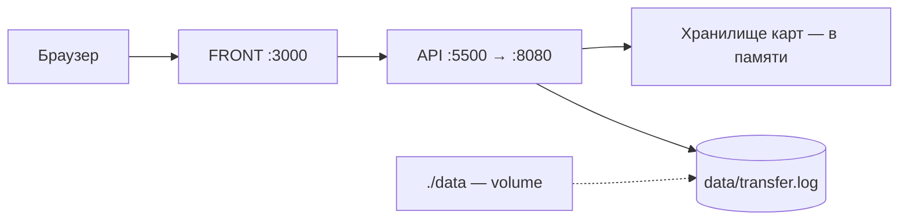

# Money Transfer Service

REST-сервис для перевода денег с карты на карту по спецификации Transfer Money API.
Заранее подготовленное веб-приложение (FRONT) подключается к сервису без доработок.

## Стек

- Java 21, Spring Boot (Web, Validation)
- Maven
- Файловое хранилище карт и операций (JSON)
- Тесты: JUnit 5, Mockito (юнит- и слайс-тесты), Testcontainers (интеграционные)
- Docker, Docker Compose

## Демо-карты

| Номер карты | Баланс    |
|-------------|-----------|
| 4111111111111111 | 100 000 руб. |
| 5555555555554444 | 50 000 руб.  |

## Особенности

- код подтверждения 0000, выводится в консоль сервиса; во FRONT подставляется автоматически
- комиссия 1% (commission-rate: 0.01);
- операция живёт 5 минут (operation-ttl-minutes);
- валюта — только RUR;
- максимальная сумма — 1 000 000,00 руб. (100 000 000 копеек)
- балансы хранятся в памяти и сбрасываются при перезапуске контейнера;

## Схема приложения

```
money-transfer/
├── README.md
├── pom.xml
├── docker/
├── docker-compose.yml
├── docker-compose.yml
├── src/
   ├── main/...
   ├── test/...
└── data/ ...
├── mvn
```

## Схема архитектуры

Слои: Controller → Service → Storage (карты в памяти) + Logger (файл).
Подробно — в [docs/ARCHITECTURE.md](docs/ARCHITECTURE.md).



Поток: FRONT отправляет перевод → сервис проверяет карты (срок действия, CVV, баланс), создаёт операцию и верификационный код → FRONT подтверждает операцию кодом → сервис завершает перевод и пишет запись в лог.

## Запуск

```
docker compose up
```
После старта:

- **FRONT** — http://localhost:3000
- **API** — http://localhost:8080 (дублируется на порту 5500 для интеграции с FRONT)

Повторный запуск после остановки: `docker compose up -d`. Остановка: `docker compose down`.

Файлы данных — переводы и записи лога сохраняются между перезапусками.

## Лог переводов

Все операции пишутся в `data/transfer.log` (в контейнере — `/app/data/transfer.log`,
каталог монтируется как volume из корня проекта). В записи фиксируются: дата,
время, карта отправителя, карта получателя, сумма, комиссия и результат.

Пример записи:

```
<!-- вставьте реальную строку из вашего лога, например:
2026-11-06 10:30:00 | operationId=1 | type=TRANSFER | cardFrom=4111****1111 | cardTo=5555****4444 | amount=10000 RUR | commission=100 RUR | result=SUCCESS
-->
```

В записи фиксируются: дата, время, карта списания, карта зачисления, сумма,
комиссия (1% от суммы) и результат операции.

## Примеры запросов

**1. Перевод** — POST `/transfer`:

```bash
curl -X POST http://localhost:8080/transfer \
  -H "Content-Type: application/json" \
  -d '{
    "cardFromNumber": "4111111111111111",
    "cardFromValidTill": "12/28",
    "cardFromCVV": "123",
    "cardToNumber": "5555555555554444",
    "amount": { "value": 10000, "currency": "RUR" }
  }'
```

Ответ — `200 OK` с идентификатором операции:

```json
{ "operationId": "49967381-bfee-41b1-b323-35ee0ac22139" }
```

**2. Подтверждение** — POST `/confirmOperation`:

```bash
curl -X POST http://localhost:8080/confirmOperation \
  -H "Content-Type: application/json" \
  -d '{ "operationId": "49967381-bfee-41b1-b323-35ee0ac22139", "code": "0000" }'
```

Ответ — `200 OK` с идентификатором операции.

**Ошибки:** `400 Bad Request` — некорректные данные, `500 Internal Server Error` —
внутренняя ошибка (например, недостаточно средств) — в соответствии со спецификацией.


## Тесты

```
mvn test
```

- Юнит- и слайс-тесты (Mockito, MockMvc) — без Docker.
- Интеграционные тесты (Testcontainers) собирают образ сервиса и гоняют полный
  цикл перевода в реальном контейнере — **нужен запущенный Docker**.

Полный прогон: 24 теста.
