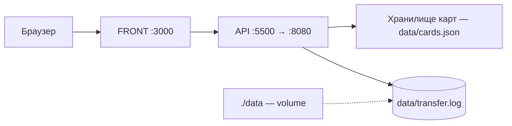

# Money Transfer Service

REST-сервис для перевода денег с карты на карту по спецификации Transfer Money API.
Заранее подготовленное веб-приложение (FRONT) подключается к сервису без доработок.

## Стек

- Java 21, Spring Boot (Web, Validation)
- Maven
- Файловое хранилище карт и операций (JSON)
- Тесты: JUnit 5, Mockito (юнит- и слайс-тесты), Testcontainers (интеграционные)
- Docker, Docker Compose

## Демо-карты

| Номер карты      | Баланс       |
|------------------|--------------|
| 4111111111111111 | 100 000 руб. |
| 5555555555554444 | 50 000 руб.  |

## Особенности

- подтверждение операции кодом: по умолчанию задан фиксированный код `0000`
  (`transfer.confirm-code` в `application.yml`) — демо-режим; если значение
  убрать, на каждую операцию будет генерироваться случайный четырёхзначный код
  (в учебном проекте проверки через FRONT фикс-код);
- операция живёт 5 минут (`operation-ttl-minutes`): просроченную подтвердить нельзя;
- максимум 3 неверных ввода кода (`max-confirm-attempts`), после чего операция
  блокируется даже при верном коде;
- комиссия 1% (`commission-rate: 0.01`), минимум 1 копейка;
- валюта — только RUR;
- максимальная сумма перевода — 1 000 000,00 руб. (100 000 000 копеек);
- балансы карт хранятся в `data/cards.json` и сохраняются между перезапусками
  (`persist-on-change: true`).

## Схема приложения

```
money-transfer/
├── README.md
├── pom.xml
├── dockerfile
├── docker-compose.yml
├── src/
│   ├── main/...
│   └── test/...
├── front/
└── data/              # карты, лог переводов (volume)
```

## Схема архитектуры



Поток: FRONT отправляет перевод → сервис проверяет карты (срок действия, CVV,
баланс), создаёт операцию и код подтверждения → FRONT подтверждает операцию
кодом → сервис списывает и зачисляет средства и пишет запись в лог.

## Запуск

```
docker compose up
```

После старта:

- **FRONT** — http://localhost:3000
- **API** — http://localhost:5500 (проброс к 8080 внутри контейнера — порт для
  интеграции с FRONT; API также доступен напрямую на http://localhost:8080)

Повторный запуск после остановки: `docker compose up -d`. Остановка: `docker compose down`.
Файлы данных (`cards.json`, `transfer.log`) лежат в каталоге `./data` и сохраняются
между перезапусками.

## Лог переводов

Все операции пишутся в `data/transfer.log` (в контейнере — `/app/data/transfer.log`,
каталог монтируется как volume из корня проекта). В записи фиксируются: дата и
время, карта отправителя, карта получателя, сумма, комиссия и результат.

Пример записи:

```
{"timestamp":"2026-11-07T17:18:04.012847674","operationId":"8d2b8384-1cd2-4a09-a3a6-45d3fdbcf11f","cardFrom":"**** 1111","cardTo":"**** 4444","amount":1000000,"commission":10000,"result":"SUCCESS"}
```

Неудачные операции (неверный код, исчерпаны попытки, истёк TTL, недостаточно
средств) также фиксируются с полем `reason` — лог отражает полную историю.

## Примеры запросов

**1. Перевод** — POST `/transfer`:

```bash
curl -X POST http://localhost:8080/transfer \
  -H "Content-Type: application/json" \
  -d '{
    "cardFromNumber": "4111111111111111",
    "cardFromValidTill": "12/28",
    "cardFromCVV": "123",
    "cardToNumber": "5555555555554444",
    "amount": { "value": 10000, "currency": "RUR" }
  }'
```

Ответ — `200 OK` с идентификатором операции:

```json
{ "operationId": "2a58d233-214b-4d07-829a-a8a9683027f3" }
```

**2. Подтверждение** — POST `/confirmOperation`:

```bash
curl -X POST http://localhost:8080/confirmOperation \
  -H "Content-Type: application/json" \
  -d '{ "operationId": "2a58d233-214b-4d07-829a-a8a9683027f3", "code": "0000" }'
```

Ответ — `200 OK` с идентификатором операции.

**Ошибки:**

- `400 Bad Request` — некорректные данные (неверный срок/CVV, карта не найдена,
  недостаточно средств, неверный код, истёкший TTL, превышен лимит попыток);
- `500 Internal Server Error` — внутренняя ошибка сервиса.

## Тесты

```
mvn test
```

- Юнит- и слайс-тесты (Mockito, MockMvc) — без Docker.
- Интеграционные тесты (Testcontainers) собирают образ сервиса и гоняют полный
  цикл перевода в реальном контейнере — **нужен запущенный Docker**.
- Отдельный `TtlIntegrationTest` проверяет жизненный цикл операции (истечение
  TTL, блокировка после лимита попыток).

Полный прогон: 35 теста.